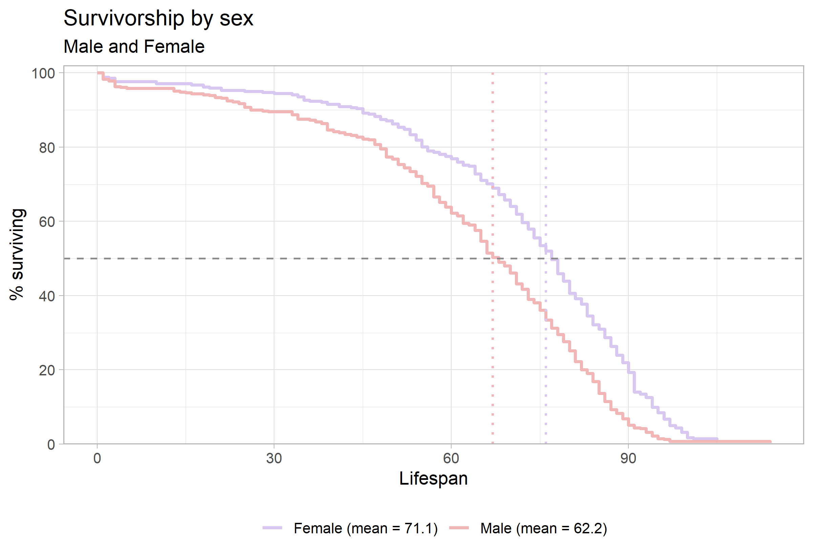

```{=latex}
\onecolumn
\begingroup
\thispagestyle{empty}
\sffamily

% Publication line and journal masthead
\noindent
\begin{minipage}[t]{0.66\linewidth}
  \scriptsize
  Hendrickson. \textit{Survivorship Curves of Sunset Hill Cemetery}
  \hfill (2026) 1:1\\
  Valdosta State University, Ecology and Evolution
\end{minipage}
\hfill
\begin{minipage}[t]{0.30\linewidth}
  \raggedleft
  \large Cemetery Demography\\[-2pt]
  \large BIOL 3250
\end{minipage}

\vspace{0.28in}

% Article-type band
\noindent
\colorbox{reportred}{%
  \parbox{\dimexpr\linewidth-2\fboxsep\relax}{%
    \color{white}
    \textbf{RESEARCH ARTICLE}\hfill
    \textbf{CLASS PROJECT}
  }%
}

\vspace{0.18in}

% Title and author line
\noindent
{\fontsize{23}{27}\selectfont
\textbf{Lifespan is Effected by Sex and Marital Status}\par}

\vspace{0.12in}

\noindent
{\small
Amos Christopher Terrell\textsuperscript{1,*}
}

\vspace{0.08in}

% Structured abstract
\setlength{\fboxsep}{6pt}
\noindent
\fcolorbox{reportred}{white}{%
  \begin{minipage}{\dimexpr\linewidth-2\fboxsep-2\fboxrule\relax}
    \small

    \textbf{Abstract}

    \vspace{3pt}

    \textbf{Purpose:}
    This project describes lifespan patterns in cemetery records and examines
    variation by sex and marital status. [you can do military service of males or pre- and post- a particular year - default 1930]

    \vspace{3pt}

    \textbf{Methods:}
    Recorded available birth and death information from gravestones
    and classified selected characteristics using evidence visible on the
    stones and in burial arrangements. [Go into much greater detail in the methods section]

    \vspace{3pt}

    \textbf{Results:}
    [Summarize the principal patterns in the class data.]

    \vspace{3pt}

    \textbf{Conclusions:}
    [State what the observed patterns suggest and note limitations. Distinguish
    lifespan in this cemetery sample from population life expectancy.]

    \vspace{3pt}

    \textbf{Keywords:}
    cemetery records; lifespan; survivorship; marital status; historical demography
  \end{minipage}%
}

% Bottom-page author and institutional details
\vfill

\noindent\rule{0.56\linewidth}{0.4pt}

\vspace{3pt}

\noindent
{\scriptsize
\textsuperscript{*}Correspondence: bhendrickson@valdosta.edu\\
\textsuperscript{1}Department of Biology, Valdosta State University,
Valdosta, Georgia, USA\\
Ecology and Evolution, BIOL 3250, Section B
}

\vspace{0.10in}

\noindent
\begin{minipage}[c]{0.20\linewidth}
  \includegraphics[width=0.72in]{Valdosta_State_University_seal.png}
\end{minipage}
\endgroup
\twocolumn
```

# Background

Cemetery records provide individual birth and death dates that can be used to describe lifespan among people represented in a burial ground. These records are a non-random sample: cemetery access, preservation of markers, migration, family burial practices, and the choice of graves to record may all affect which people appear in the dataset. The analyses below therefore describe the collected sample and should not be treated as direct estimates of lifespan for an entire town or historical population.

# Hypotheses

Write each hypothesis before interpreting the figures. State the expected direction and identify the comparison.

2. **Marriage and lifespan:** I hypothesize that married women will have a greater lifespan than unmarried women than because mental health and physical heatlh goes hand to hand and people that have a lifelong companion have a higher rate of survival. 

# Methods

Complete the prompts below. Replace bracketed text with details from the field visit and the final class dataset.

## Field site and sampling

- **Where did you go?** We went to the sunset hill cemetery in Valdosta, Georgia next to the VSU Campus between North Oak Street and West Mary street.
- **What date and time of day did you collect records?** This experiment was conducted October 8, 2026 on Thursday from 2:15 EST- 3:30 EST
- **What part of the cemetery did you sample?** We stayed towards the north eastern part of the cemetry away from the main gate
- **How did you choose graves?** Some graves had been eroded to the point to were they were no longer legiable. We chose the graves that were easier to read to be more effiecent with our time. 
- **How did you handle nearby graves and family plots?** When coming across the family plots My partner and I would only sample 2-3 people from the group, and then move to next plot. We also mainly focused on the mother and father that were married.

## Recorded information and variable definitions

- **What information did you record from each marker?** When gathering data from the headstones. We mainly focused on brith date, death date, sex, and status.
- **How was lifespan calculated?** To calaculate lifespan we smiply just subtracted the death date from birth date.
- **How did you determine marital status?** There were some obvious markers describing a loving Husband/Wife, but some graves were marked as mother and father on family plots placed side by side. Those graves counted as wife and husband.
- **How did you determine military service?** The markers on the grave helped determine if the samples in the data set were vetrans.                           - 
-**How did you determine sex or gender?** The markers on the grave (Husband, Mother, Father, etc.) were used to identfy the sex of people used in the data set
- **How were missing, illegible, or ambiguous records handled?** Did not record the graves that were not legible.

## Dataset and analysis

- **How many records were collected by you?** We recorded 51 people in total. 
- **How many records were included in the final analysis?**  The sample set was toatl of 752 samples. 
- **Were records aggregated with the class dataset?** It was hard to tell if there were duplicates in the data set since there are two sections combined data, but I assume there were multiple duplicates.
- **What summaries or plots were produced?** The graph shows the differences between married women and males surviability rate.
- **What are the limits of the sample?** The samples obsereved were skewed since there were multiple diffrent generations in the cementry. The younger generations had much longer survivabilty rates since with time health care became better.

# Results

The summary table in @fig-summary shows substantial differences in recorded lifespan by sex in this sample. Males had a mean lifespan of 59.0 years (SD = 20.4; n = 3), compared with 29.7 years (SD = 7.1; n = 3) for females. The marital-status breakdown is more tentative because each subgroup contains only one or two records. Among males, the two married individuals had a mean lifespan of 70.5 years (SD = 6.4), while the one unmarried individual lived 36 years. Among females, the one married individual lived 36 years, compared with a mean of 26.5 years (SD = 6.4) for the two unmarried individuals. These small subgroup sizes make the values descriptive; they do not support broad conclusions about sex or marital status.

{#fig-summary width=90% fig-pos="t" fig-env="figure*"}

*The sex-specific survivorship curves in @fig-sex show a different pattern: the plotted means are 61.1 years for males and 57.3 years for females. The male curve remains higher through much of the earlier and middle lifespan, while the female curve reaches the 50% survival point later. The curves are close and change relative position, so the figure suggests that the sex difference depends on which part of the lifespan distribution is considered. The median markers indicate where each group’s observed curve reaches 50% surviving; they are distinct from the mean values shown in the legend.*

{#fig-sex width=70% fig-pos="t" fig-env="figure*"}

The within-sex comparisons in @fig-married show higher plotted mean lifespans for married than unmarried individuals in both panels. For males, the plotted means are 64.3 years for married individuals and 55.4 years for unmarried individuals. For females, they are 64.3 and 46.3 years, respectively. The curves also place the 50% survival point later for the married groups. These are descriptive differences and should not be interpreted as evidence that marriage caused longer lifespan; other factors and the sizes and composition of the groups could contribute.*

{#fig-married width=70% fig-pos="t" fig-env="figure*"}

**Summary of observed results:** As seen in the results it was pretty clear that married men and women had similar means of age survived. Unmarried samples had a way lower surviability rate than the counterpart.

# Discussion


**Marital status and social relationships.** Marriage can correlate with social support, health behaviors, household resources, and social integration, but people’s health can also influence whether they marry or remain married. A large meta-analysis found associations between unmarried status and mortality, with some associations differing by sex [@wangSexDifferencesAssociation2020]; a broader meta-analysis linked social relationships with mortality risk [@holt-lunstadSocialRelationshipsMortality2010]. In this dataset, the comparison of married and not-married records among women was darstically diffrent those who were married lived an average of 8 years longer. These cemetery records do not measure relationship quality, social contact, or the timing and duration of marriage, so marital status should be treated as an imperfect indicator rather than a direct measure of socialization or a cause of longevity.

```{=latex}
\newpage
```

### References

::: {#refs} 
::: 
